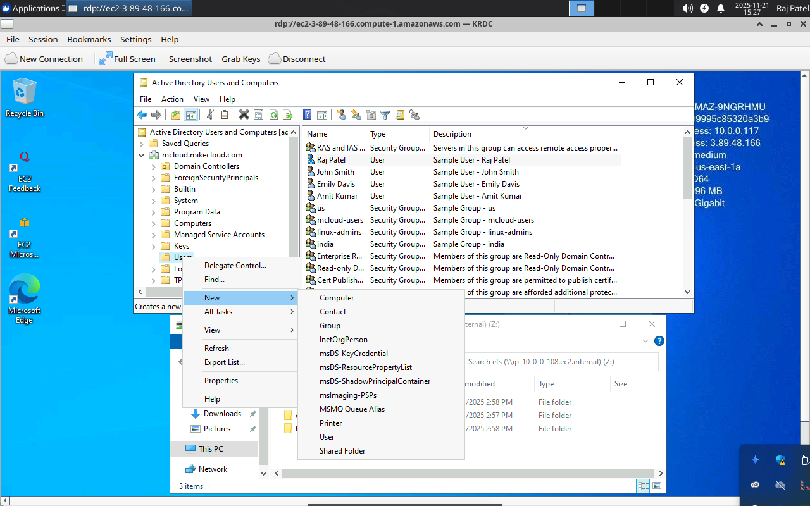

# RStudio Server Cluster on OCI: Instance Pool, File Storage and Active Directory

An **RStudio Server** cluster for shared data-science work, built on the
[OCI Mini Active Directory](https://github.com/mamonaco1973/oci-mini-ad)
lab. A flexible **OCI load balancer** spreads users across an autoscaling
**instance pool** of RStudio instances built from a **Packer** image; every
instance joins a **mini-AD** domain, so users sign in with their AD accounts,
and mounts the same **OCI File Storage** export for home directories, shared
data and a shared R package library. A Windows VM and a Samba gateway give
admins access to the same files.


| Piece | Where | Role |
|---|---|---|
| **rstudio-lb** | public | flexible load balancer (10 to 100 Mbps); HTTP 80; round robin to 8787 with the `RSTUDIO_SESSION` cookie; health check `/` |
| **rstudio-pool** | `cluster-subnet` (`10.0.0.128/26`, private) | instance pool from `rstudio-instance-config`: `VM.Standard.E4.Flex`, 2 OCPUs and 8 GB; 2 to 4 instances, adds one above 60% CPU and removes one below 10% |
| **rstudio-image** | built by Packer | R (latest CRAN), RStudio Server (open source), and the AD and NFS packages |
| **rstudio-fss** | File Storage | file system, mount target `rstudio-fss-mt` and export `/nfs`, mounted over NFSv3 |
| **smb-gateway-&lt;hex&gt;** | `vm-subnet` (`10.0.0.64/26`, public) | Ubuntu, E4.Flex 1 OCPU / 4 GB, public IP; joined to AD; mounts the export and serves `/nfs` over Samba |
| **win-&lt;hex&gt;** | `vm-subnet` | Windows Server 2022, E4.Flex 2 OCPU / 8 GB, public IP; joined to AD; maps the gateway's share as `Z:` |
| **mini-AD** | private AD subnet | [`module-oci-mini-ad`](https://github.com/mamonaco1973/module-oci-mini-ad) Samba DC for `mcloud.mikecloud.com` (`MCLOUD`) |
| **OCI Bastion** | VCN | SSH port forwarding to the domain controller, used by `connect.sh` |
| **mini-ad-vcn** | `10.0.0.0/24` | internet gateway for the VM subnet, NAT gateway for the private ones |

## Architecture

<picture>
  <source media="(prefers-color-scheme: dark)" srcset="architecture-dark.svg">
  
</picture>

Regenerate with `python3 make_diagram.py`. The gateway and Windows VM also
join the domain; those lines are left off the diagram to keep it readable.

- **`01-directory/`**: the VCN, subnets, gateways and security lists, OCI
  Bastion, the SSH key pair (written to `keys/`, gitignored), random
  passwords, and the mini-AD DC with users and groups from
  `scripts/users.json.template`.
- **`02-servers/`**: File Storage, the gateway and Windows instances, and
  their network security groups.
- **`03-packer/`**: the RStudio image (`rstudio_image.pkr.hcl` and its
  install scripts).
- **`04-cluster/`**: the instance configuration, pool and autoscaling, the
  load balancer, and `scripts/rstudio_booter.sh`.
- **`05-rsamples/`**: sample R scripts and `packages.R`.
- **`06-utils/`**: `getNextUID` / `getNextGID` scripts for adding AD users.
- **`connect.sh`**: opens a Bastion session and SSH tunnel to the domain
  controller (or another private IP you pass).
- **`get_password.sh <user>`**: prints a user's password from Terraform
  state (`admin`, `ubuntu`, `jsmith`, `edavis`, `rpatel`, `akumar`,
  `windows_local_admin`).

## How an instance starts

The instance configuration's user data runs `rstudio_booter.sh`, which
mounts the export as `/nfs` (and its `home` directory as `/home`), joins the
domain with `realm join` using the admin password templated into it, sets up
SSSD with short names and the POSIX IDs from AD, gives `linux-admins`
passwordless sudo, and writes `Rprofile.site` so the library path is the
user's own library, then `/nfs/rlibs`, then the system library.
`/nfs/rlibs` belongs to `rstudio-admins`.

## Users and groups

| User | uidNumber | Groups | Notes |
|---|---|---|---|
| jsmith | 10001 | mcloud-users, us, linux-admins, rstudio-admins, Domain Admins | sudo; writes `/nfs/rlibs` |
| edavis | 10002 | mcloud-users, us | |
| rpatel | 10003 | mcloud-users, india, linux-admins, rstudio-admins, Domain Admins | sudo; writes `/nfs/rlibs` |
| akumar | 10004 | mcloud-users, india | |

| Group | gidNumber |
|---|---|
| mcloud-users | 10001 (every user's primary group) |
| us | 10002 |
| india | 10003 |
| linux-admins | 10004 |
| rstudio-admins | 10005 |

## Prerequisites

* [An OCI Account](https://cloud.oracle.com/)
* [Install OCI CLI](https://docs.oracle.com/en-us/iaas/Content/API/SDKDocs/cliinstall.htm),
  configured with a `DEFAULT` profile in `~/.oci/config`
* [Install Terraform](https://developer.hashicorp.com/terraform/install)
* [Install Packer](https://developer.hashicorp.com/packer/install)
* [Install jq](https://jqlang.github.io/jq/download/)

## Deploy

```bash
git clone https://github.com/mamonaco1973/oci-rstudio-cluster.git
cd oci-rstudio-cluster
./apply.sh
```

`apply.sh` applies `01-directory` and `02-servers`, builds `rstudio-image`
with Packer, and applies `04-cluster`. It ends by running `validate.sh`,
which prints a summary:

```
============================================================================
RStudio Cluster - Deployment Summary
============================================================================

  Domain Controller (private)
    IP       : 10.0.0.x
    Connect  : ./connect.sh

  Linux Samba Gateway (public)
    IP       : 129.x.x.x
    SSH      : ssh -i 01-directory/keys/Private_Key ubuntu@129.x.x.x
    NFS/SMB  : Z: drive on Windows maps to \\129.x.x.x\nfs

  Windows AD Client (public)
    IP       : 129.x.x.x
  ...
```

## Try it

1. Open `http://<load balancer IP>` and sign in as one of the users above;
   `./get_password.sh jsmith` prints the password.
2. Open a sample from `05-rsamples`; the gateway clones this repository
   into the export.
3. Add a user:
   1. RDP to the Windows VM as `jsmith` or `rpatel` and open **Active
      Directory Users and Computers** with **View > Advanced Features** on.
   2. Under the domain's **Users** container, create the user with a UPN
      such as `mcloud@mcloud.mikecloud.com` and an initial password.

      

   3. Run `Z:\oci-rstudio-cluster\06-utils\getNextUID.bat` for the next
      free `uidNumber`.
   4. In **Attribute Editor**, set `uidNumber` to that value, `gidNumber` to
      `10001`, and `uid` to the login name.
   5. Under **Member Of**, add `mcloud-users` and any other groups.
   6. SSH to the gateway and check the mapping with `id mcloud`:

      

   7. Sign in to RStudio as the new user. They can't write `/nfs/rlibs`
      until they're in `rstudio-admins`.

## Teardown

```bash
./destroy.sh
```

`destroy.sh` destroys `04-cluster`, deletes the Packer image, then destroys
`02-servers` and `01-directory`.

## Notes

- **Lab only.** RStudio is served over plain HTTP. SSH (22) and HTTP (80)
  on the VM subnet and RDP (3389) on the Windows VM are open to
  `0.0.0.0/0`, and the Bastion accepts sessions from any address.
- There's no Vault: passwords live in Terraform state, and the AD admin
  password is templated into the instance configuration's user data, so
  anyone who can read the instance metadata can read it.
- The old README listed `india` as 10002 and `us` as 10003; the template
  sets `us` to 10002 and `india` to 10003.
